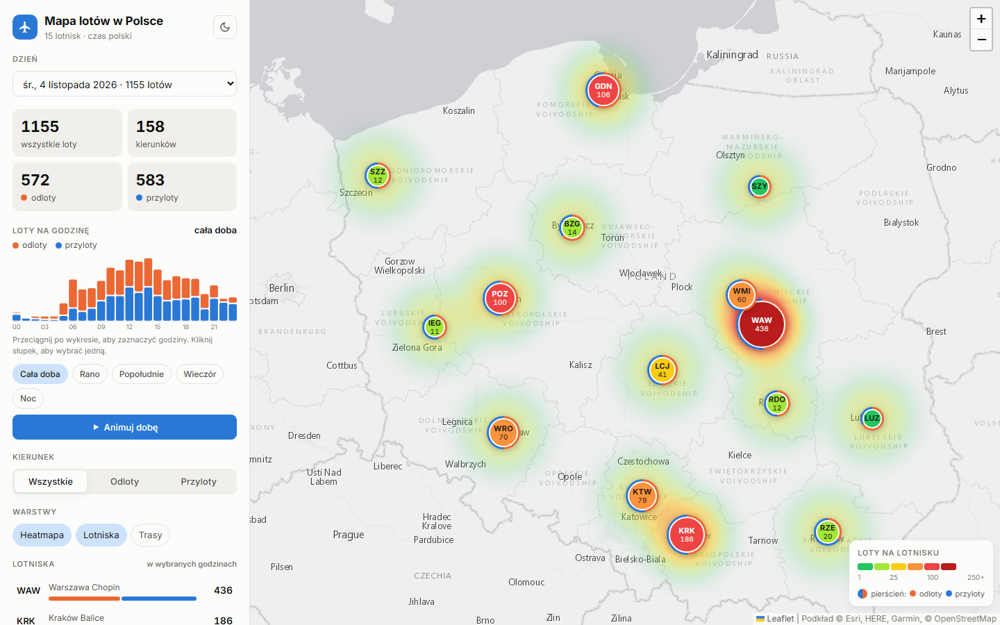
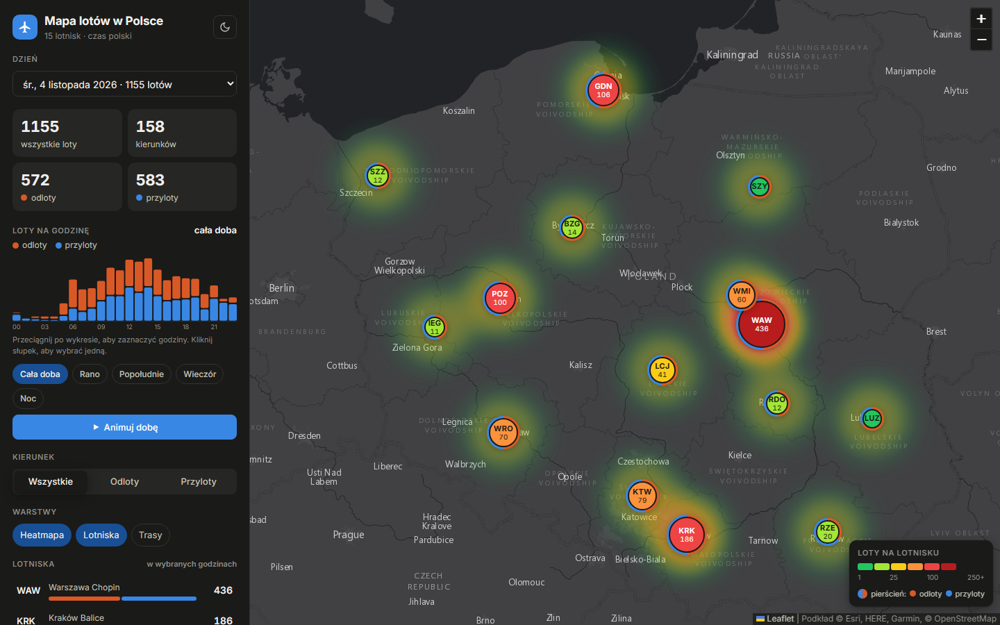

# ✈️ Polish Air Traffic Map

🇬🇧 English · [🇵🇱 Polski](README.md)

An interactive map of air traffic at 15 Polish airports: traffic heatmap, routes to destination airports, hourly breakdown and airport ranking. Flight data comes from the [OpenSky Network](https://opensky-network.org) and is collected by a Node.js exporter that runs daily on GitHub Actions.

> 🎓 Originally built as a university project for the **Information Visualization** course, then extended.

**[▶ Live demo](https://easyk0.github.io/polish-air-traffic/?lang=en)**



## Features

- **Heatmap and airport badges:** colour from green (low traffic) to red (high), IATA code and flight count on each badge, a ring showing the departure/arrival split.
- **Routes:** arcs to destination airports, line width by number of flights (coordinates of ~5,900 airports from OurAirports).
- **Hour selection:** drag across the hourly chart, pick a time of day (morning, afternoon, evening, night) or animate the whole day.
- **Direction filter:** all flights, departures only or arrivals only.
- **Airport details:** click an airport to see its hourly chart and top destinations.
- **Day picker** across saved exports, local time (Europe/Warsaw).
- **Polish / English** interface, **light and dark theme**, mobile layout, keyboard support.

<details>
<summary>Dark theme</summary>


</details>

## How it works

```
OpenSky REST API (OAuth2)  ─┐
                            ├─>  export.mjs  ─>  data/flights_YYYY-MM-DD.csv  ─>  index.html (Leaflet)
AeroDataBox (optional)     ─┘                    data/index.json (list of days)
```

- `export.mjs` fetches the day's departures and arrivals for every airport, removes duplicates, retries failed requests and writes a CSV plus `data/index.json`.
- `sources/opensky.mjs`: OAuth2 client-credentials login with automatic token refresh and rate-limit handling (HTTP 429).
- `sources/aerodatabox.mjs`: alternative source via API.Market (requires a subscription).
- `index.html`: a static page (Leaflet, Leaflet.heat, no framework, no build step) that reads the CSV files from `data/`.

## Running locally

Requirements: [Node.js](https://nodejs.org) 18+ and Python 3 (for the local server).

1. Copy `api_key.template.txt` to `api_key.txt` and fill in the API client from your OpenSky account (`OPENSKY_CLIENT_ID`, `OPENSKY_CLIENT_SECRET`).
2. Download yesterday's flights and open the map:

```bash
start.bat export
```

Map only, using saved data:

```bash
start.bat
```

Other export options:

```bash
node export.mjs --date=2026-11-03
node export.mjs --source=aerodatabox --airports=EPWA,EPKK
```

On macOS/Linux run `node export.mjs` and serve the folder with any static server, e.g. `python3 -m http.server 8000`.

## Automatic updates

The [`.github/workflows/daily-export.yml`](.github/workflows/daily-export.yml) workflow runs every morning: it downloads the previous day from OpenSky, saves it in `data/` (keeping the last 60 days) and commits it, after which GitHub Pages refreshes the demo. It needs the repository secrets `OPENSKY_CLIENT_ID` and `OPENSKY_CLIENT_SECRET`. A specific day can be fetched manually from the Actions tab (*Run workflow*).

## Project structure

| Path | Description |
|---|---|
| `index.html` | the app (map, sidebar, chart) |
| `export.mjs` | flight export to CSV |
| `sources/` | data sources: OpenSky, AeroDataBox |
| `lib/common.mjs` | time-zone dates, HTTP with retries, CSV |
| `tools/build_airports.mjs` | builds `data/airports_coords.json` from OurAirports |
| `data/` | saved days and airport coordinates |
| `start.bat` | one-click start (Windows) |

## Data and licences

- Flights: [OpenSky Network](https://opensky-network.org) (non-commercial and research use). Destination airports are estimated from ADS-B signals, so some flights have no known destination.
- Airport coordinates: [OurAirports](https://ourairports.com/data/) (public domain).
- Basemap: Esri World Gray Canvas, © OpenStreetMap.
