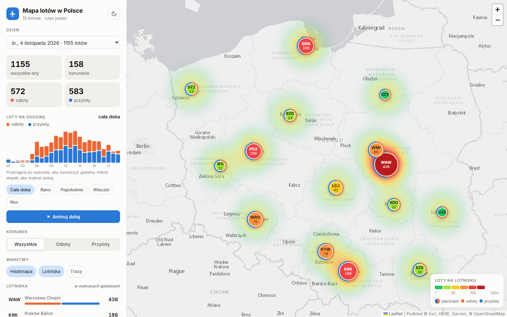
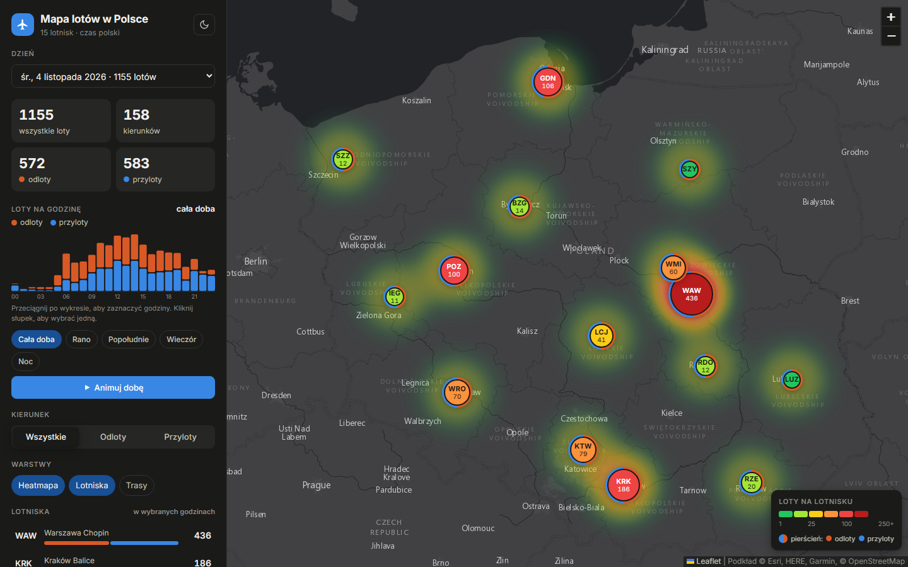

# ✈️ Mapa lotów w Polsce

Interaktywna mapa ruchu lotniczego na 15 polskich lotniskach: heatmapa natężenia ruchu, trasy do lotnisk docelowych, rozkład godzinowy i ranking lotnisk. Dane pochodzą z [OpenSky Network](https://opensky-network.org) i są pobierane skryptem Node.js.

**[▶ Zobacz demo](https://easyk0.github.io/polish-air-traffic/)**



## Funkcje

- **Heatmapa i plakietki lotnisk:** kolor od zielonego (mały ruch) do czerwonego (duży), kod IATA i liczba lotów na plakietce, pierścień z podziałem na odloty i przyloty.
- **Trasy:** łuki do lotnisk docelowych, grubość zależy od liczby lotów (współrzędne ~5900 lotnisk z OurAirports).
- **Wybór godzin:** przeciągnięcie po wykresie godzinowym, gotowe pory dnia (rano, popołudnie, wieczór, noc) albo animacja całej doby.
- **Filtr kierunku:** wszystkie loty, same odloty albo same przyloty.
- **Szczegóły lotniska:** po kliknięciu wykres godzinowy tego lotniska i najczęstsze kierunki.
- **Wybór dnia** spośród zapisanych eksportów, czas lokalny (Europe/Warsaw).
- **Jasny i ciemny motyw**, układ dopasowany do telefonu, obsługa klawiaturą.

<details>
<summary>Ciemny motyw</summary>


</details>

## Jak to działa

```
OpenSky REST API (OAuth2)  ─┐
                            ├─>  export.mjs  ─>  data/flights_YYYY-MM-DD.csv  ─>  index.html (Leaflet)
AeroDataBox (opcjonalnie)  ─┘                    data/index.json (lista dni)
```

- `export.mjs` pobiera odloty i przyloty z wybranego dnia dla każdego lotniska, usuwa duplikaty, ponawia nieudane zapytania i zapisuje CSV oraz `data/index.json`.
- `sources/opensky.mjs`: logowanie OAuth2 (client credentials) z automatycznym odświeżaniem tokenu i obsługą limitów (HTTP 429).
- `sources/aerodatabox.mjs`: alternatywne źródło przez API.Market (wymaga subskrypcji).
- `index.html`: statyczna strona (Leaflet, Leaflet.heat, bez frameworka i bez kroku budowania), czyta CSV z folderu `data/`.

## Uruchomienie lokalne

Wymagania: [Node.js](https://nodejs.org) 18+ i Python 3 (do lokalnego serwera).

1. Skopiuj `api_key.template.txt` jako `api_key.txt` i wpisz dane klienta API z konta OpenSky (`OPENSKY_CLIENT_ID`, `OPENSKY_CLIENT_SECRET`).
2. Pobierz wczorajszy dzień i otwórz mapę:

```bash
start.bat export
```

Sama mapa na zapisanych danych:

```bash
start.bat
```

Inne opcje eksportu:

```bash
node export.mjs --date=2026-11-03
node export.mjs --source=aerodatabox --airports=EPWA,EPKK
```

## Struktura

| Ścieżka | Opis |
|---|---|
| `index.html` | aplikacja (mapa, panel, wykres) |
| `export.mjs` | eksport lotów do CSV |
| `sources/` | źródła danych: OpenSky, AeroDataBox |
| `lib/common.mjs` | daty w strefie czasowej, HTTP z ponawianiem, CSV |
| `tools/build_airports.mjs` | generuje `data/airports_coords.json` z OurAirports |
| `data/` | zapisane dni i współrzędne lotnisk |
| `start.bat` | uruchomienie jednym kliknięciem (Windows) |

## Dane i licencje

- Loty: [OpenSky Network](https://opensky-network.org) (do zastosowań niekomercyjnych i badawczych). Lotniska docelowe są szacowane z sygnałów ADS-B, więc część lotów nie ma ustalonego celu.
- Współrzędne lotnisk: [OurAirports](https://ourairports.com/data/) (domena publiczna).
- Podkład mapy: Esri World Gray Canvas, © OpenStreetMap.

---

## English summary

Interactive map of air traffic at 15 Polish airports: heatmap, routes, hourly histogram with brush selection, per-airport details, light/dark theme. A Node.js exporter pulls daily departures/arrivals from the OpenSky Network REST API (OAuth2 client credentials, retry and rate-limit handling) into CSV files; a static Leaflet page visualizes them. No build step: run `start.bat export` (Windows) or `node export.mjs` and serve the folder with any static server.
